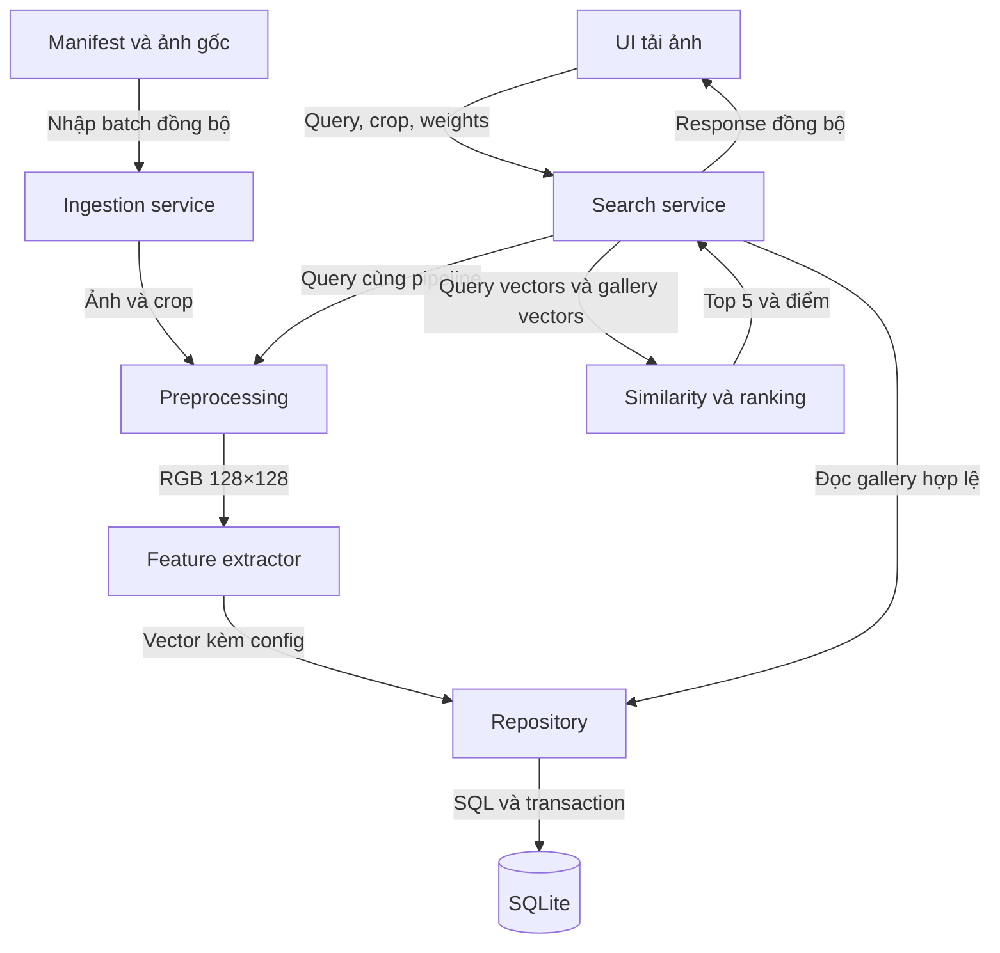

# Kiến trúc hệ thống

## 1. Kiểu kiến trúc

Ứng dụng cục bộ một tiến trình, chia module theo trách nhiệm. Streamlit gọi service Python; repository truy cập SQLite. Không cần REST API, queue hoặc microservice để hoàn thành baseline. 'Interface contract' trong dự án này chủ yếu là hợp đồng hàm Python.

## 2. Sơ đồ khối

Mũi tên thể hiện dữ liệu/hành động, không đồng nghĩa HTTP. Toàn bộ baseline là xử lý đồng bộ. Trích xuất gallery chạy bằng script batch trước demo, không chạy lại toàn gallery khi người dùng nhấn tìm.

## 3. Boundary và I/O

| Module | Đầu vào | Đầu ra | Trách nhiệm |
| --- | --- | --- | --- |
| UI | File upload, crop, weights | SearchRequest | Nhận thao tác, hiển thị; không SQL |
| Preprocessing | Bytes/path ảnh, crop | RGB array + metadata | EXIF, màu, crop, resize |
| Feature extractor | RGB, bundle config | FeatureBundle | HSV/HOG/LBP; không lưu DB |
| Similarity | Hai bundle + weights | Scores | Toán học thuần; không UI/DB |
| Repository | Entity/config/id | Records/vectors | SQL, validation persistence, transaction |
| Ingestion | Manifest | ImportSummary | Điều phối nhập, trạng thái, lỗi từng ảnh |
| Search service | SearchRequest | SearchResponse | Điều phối query, gallery, rank, log |
| Visualization | Ảnh, đặc trưng, scores | Hình/bảng | Minh họa; không tính công thức khác |
| Evaluation | Query set + judgments | Metrics, per-query CSV | Đánh giá tái lập |

## 4. Luồng nhập gallery

1. Đọc manifest, kiểm tra cột và đường dẫn.
2. Kiểm tra checksum gốc để phát hiện đã nhập.
3. Chuẩn hóa theo crop và preprocess-v1.
4. Lưu metadata, ghi pending/approved theo kết quả duyệt.
5. Trích xuất ba bộ đặc trưng, kiểm tra số chiều và finite.
6. Lưu vectors theo config_id.
7. Tổng kết created/skipped/failed và lỗi cụ thể.

Một ảnh lỗi không làm mất dữ liệu ảnh đã nhập thành công trước đó. ImportSummary phải khớp tổng dòng; không ghi 'thành công toàn bộ' nếu còn failed.

## 5. Luồng query

1. UI tạo SearchRequest.
2. Service kiểm tra ảnh và weights, chuẩn hóa ảnh.
3. Extractor tạo FeatureBundle giống gallery.
4. Repository tải các ứng viên đã duyệt và đủ config.
5. Xác nhận file ảnh kết quả còn tồn tại; gallery có path hỏng phải bị loại hoặc sửa trước demo.
6. Similarity tính ba điểm, weighted sum, sort ổn định.
7. Service ghi query và 5 kết quả atomically.
8. UI hiển thị ảnh query, top 5, bảng điểm và warnings.

Không lọc theo loài. Không cần tên loài của query để tìm kiếm. Nhãn gallery chỉ được hiển thị hoặc phục vụ đánh giá.

## 6. Cache và hiệu năng

Ban đầu đọc DB mỗi query để dễ đúng. Chỉ thêm cache sau khi đo cho thấy cần. Nếu cache vectors, khóa phải gồm bundle ID và phiên bản gallery; nhập thêm/xóa mềm/rebuild phải vô hiệu cache. Không cache theo bundle đơn thuần rồi tiếp tục dùng dữ liệu cũ.

Độ phức tạp so sánh khoảng O(ND), N là số ảnh, D tổng số chiều; sắp xếp O(N log N). Với dữ liệu nhỏ, ưu tiên tính đúng và giải thích được. Các con số latency phải đo thực tế.

## 7. Quyết định thiết kế

| ID | Quyết định | Lý do và giới hạn |
| --- | --- | --- |
| ADR01 | SQLite và file ảnh ngoài DB | Demo dễ; phải bàn giao cả thư mục ảnh |
| ADR02 | HSV+HOG+LBP | Diễn giải được; không hứa tìm đúng loài mọi ảnh |
| ADR03 | Exact scan | Đơn giản; chưa tối ưu hàng triệu ảnh |
| ADR04 | Crop thủ công/bán thủ công | Dữ liệu đề yêu cầu chính diện; chưa có detector |
| ADR05 | Hàm nội bộ thay REST | Một ứng dụng cục bộ; ít chỗ sai giao tiếp |
| ADR06 | Config bất biến | Tránh so sánh sai và giữ lịch sử có nghĩa |

## 8. Lỗi và khả năng quan sát

Log gồm thời điểm, stage, image_id/query_id khi có, mã lỗi, thông điệp. UI hiển thị hướng xử lý như 'chọn lại ảnh' hoặc 'trích xuất bổ sung gallery'. Không đưa stack trace dài vào giao diện chính. Script phải có exit code khác 0 khi gặp lỗi toàn cục như DB không mở được.
