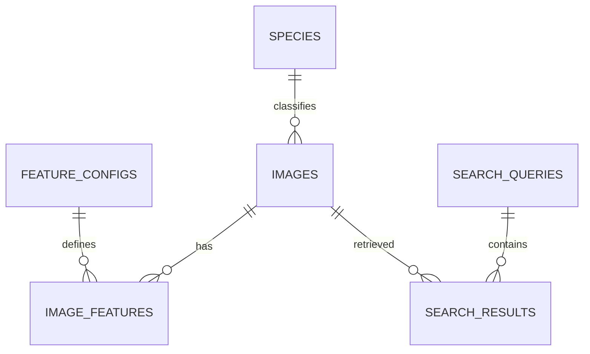

# Thiết kế CSDL

## 1. Quyết định lưu trữ

Baseline dùng SQLite. File ảnh gốc và PNG chuẩn hóa nằm dưới data/; DB lưu đường dẫn tương đối, metadata và vector JSON. Vector nằm trong CSDL, không chỉ trong file NumPy. Nếu giảng viên yêu cầu lưu bytes ảnh trong DB, bổ sung BLOB bằng migration; không tự coi đường dẫn là đáp ứng quy định đó.

Lưu JSON giúp đọc và demo thuận tiện, đổi lại tốn dung lượng hơn binary. Với 500 ảnh, mỗi ảnh 2052 số (128+1764+160), tổng khoảng 1.026.000 số; nếu dùng float32 thuần thì khoảng 4,1 MB chưa tính metadata, còn JSON lớn hơn tùy cách biểu diễn. Đây là tính toán dung lượng lý thuyết, chưa phải kích thước DB thực tế.

## 2. ERD



Nhãn species có thể NULL khi chưa biết. Gallery và query đánh giá phân biệt bằng split. FeatureConfigs bất biến sau khi được sử dụng; bộ bundle được lưu dưới dạng mapping config ID trong search_config của truy vấn.

## 3. Từ điển dữ liệu

### Species
- species_id: khóa chính số nguyên.
- name: tên loài chuẩn, duy nhất; chuẩn hóa khoảng trắng trước ghi.

### Images
- image_id: định danh nội bộ.
- species_id: khóa ngoại tùy chọn.
- original_path / processed_path: đường dẫn từ data/, không phải URL tạm thời.
- width / height / channels: kích thước ảnh đã xử lý.
- original_sha256: checksum file gốc để nhập lại không tạo trùng.
- processed_sha256: checksum RGB pixel đã chuẩn hóa; có index, không ép unique để có thể rà soát trước khi loại.
- source_url / license_note: nguồn và ghi chú sử dụng.
- split: gallery, validation hoặc test.
- group_id: nhóm gần trùng/cùng nguồn để chia tập.
- crop_json: {x,y,size} theo tọa độ sau EXIF.
- preprocess_version: mặc định preprocess-v1.
- quality_status: pending, approved hoặc rejected.
- active: có tham gia sử dụng không; xóa mềm giữ lịch sử.
- review_note, created_at: ghi chú duyệt và thời điểm UTC.

### FeatureConfigs
- config_id: khóa chính.
- name: tên config duy nhất, ví dụ hsv-v1.
- feature_type: HSV, HOG hoặc LBP.
- dimension: số chiều.
- parameters_json: tham số thuật toán, quy tắc chuẩn hóa, versions thư viện.
- preprocess_version: phải khớp ảnh/query.

### ImageFeatures
- Khóa chính ghép (image_id, config_id).
- vector_json: mảng số, không phải chuỗi nhãn.
- vector_norm: L2 norm để chẩn đoán, không thay thế vector.
- warning: zero_gradient hoặc NULL.
- created_at: thời điểm trích xuất.

### SearchQueries
- query_id: khóa chính.
- query_path: PNG chuẩn hóa của query.
- query_sha256: checksum pixel để nhận diện query.
- search_config_json: bundle IDs, trọng số hiệu lực, k=5, preprocess_version, phiên bản thuật toán, snapshot manifest/version, môi trường thực thi.
- candidate_count: số ứng viên thực tế hợp lệ.
- duration_ms: thời gian tiền xử lý + extract + load + rank; không gồm UI render. Chi tiết từng giai đoạn nằm trong timings_json.

### SearchResults
- Khóa chính ghép (query_id, rank); UNIQUE(query_id, image_id).
- rank từ 1 đến 5; image_id tham chiếu ảnh.
- hsv_score, hog_score, lbp_score, total_score: điểm chưa làm tròn, [0,1].

## 4. DDL SQLite baseline

Khối dưới đây là schema nguồn để chép vào migrations/001_init.sql khi triển khai. Bật foreign_keys trên **mỗi kết nối**, không chỉ lúc tạo bảng. JSON lưu dạng TEXT; kiểm tra cấu trúc JSON, độ dài và tính hữu hạn ở repository để tránh phụ thuộc extension JSON của SQLite.

```sql
PRAGMA foreign_keys = ON;

CREATE TABLE species (
    species_id INTEGER PRIMARY KEY,
    name TEXT NOT NULL UNIQUE
);

CREATE TABLE images (
    image_id INTEGER PRIMARY KEY,
    species_id INTEGER REFERENCES species(species_id) ON DELETE RESTRICT,
    original_path TEXT NOT NULL,
    processed_path TEXT NOT NULL,
    width INTEGER NOT NULL CHECK (width = 128),
    height INTEGER NOT NULL CHECK (height = 128),
    channels INTEGER NOT NULL CHECK (channels = 3),
    original_sha256 TEXT NOT NULL UNIQUE CHECK (length(original_sha256) = 64),
    processed_sha256 TEXT NOT NULL CHECK (length(processed_sha256) = 64),
    source_url TEXT,
    license_note TEXT,
    split TEXT NOT NULL CHECK (split IN ('gallery', 'validation', 'test')),
    group_id TEXT NOT NULL,
    crop_json TEXT NOT NULL,
    preprocess_version TEXT NOT NULL,
    quality_status TEXT NOT NULL DEFAULT 'pending'
        CHECK (quality_status IN ('pending', 'approved', 'rejected')),
    active INTEGER NOT NULL DEFAULT 1 CHECK (active IN (0, 1)),
    review_note TEXT,
    created_at TEXT NOT NULL DEFAULT CURRENT_TIMESTAMP
);

CREATE TABLE feature_configs (
    config_id INTEGER PRIMARY KEY,
    name TEXT NOT NULL UNIQUE,
    feature_type TEXT NOT NULL CHECK (feature_type IN ('HSV', 'HOG', 'LBP')),
    dimension INTEGER NOT NULL CHECK (dimension > 0),
    parameters_json TEXT NOT NULL,
    preprocess_version TEXT NOT NULL,
    created_at TEXT NOT NULL DEFAULT CURRENT_TIMESTAMP
);

CREATE TABLE image_features (
    image_id INTEGER NOT NULL REFERENCES images(image_id) ON DELETE RESTRICT,
    config_id INTEGER NOT NULL REFERENCES feature_configs(config_id) ON DELETE RESTRICT,
    vector_json TEXT NOT NULL,
    vector_norm REAL NOT NULL CHECK (vector_norm >= 0),
    warning TEXT,
    created_at TEXT NOT NULL DEFAULT CURRENT_TIMESTAMP,
    PRIMARY KEY (image_id, config_id)
);

CREATE TABLE search_queries (
    query_id INTEGER PRIMARY KEY,
    query_path TEXT NOT NULL,
    query_sha256 TEXT NOT NULL CHECK (length(query_sha256) = 64),
    search_config_json TEXT NOT NULL,
    candidate_count INTEGER NOT NULL CHECK (candidate_count >= 5),
    duration_ms REAL NOT NULL CHECK (duration_ms >= 0),
    timings_json TEXT NOT NULL,
    created_at TEXT NOT NULL DEFAULT CURRENT_TIMESTAMP
);

CREATE TABLE search_results (
    query_id INTEGER NOT NULL REFERENCES search_queries(query_id) ON DELETE CASCADE,
    rank INTEGER NOT NULL CHECK (rank BETWEEN 1 AND 5),
    image_id INTEGER NOT NULL REFERENCES images(image_id) ON DELETE RESTRICT,
    hsv_score REAL NOT NULL CHECK (hsv_score BETWEEN 0 AND 1),
    hog_score REAL NOT NULL CHECK (hog_score BETWEEN 0 AND 1),
    lbp_score REAL NOT NULL CHECK (lbp_score BETWEEN 0 AND 1),
    total_score REAL NOT NULL CHECK (total_score BETWEEN 0 AND 1),
    PRIMARY KEY (query_id, rank),
    UNIQUE (query_id, image_id)
);

CREATE INDEX idx_images_gallery ON images(split, active, quality_status);
CREATE INDEX idx_images_species ON images(species_id);
CREATE INDEX idx_images_processed_hash ON images(processed_sha256);
CREATE INDEX idx_images_group ON images(group_id);
CREATE INDEX idx_features_config ON image_features(config_id, image_id);
CREATE INDEX idx_queries_time ON search_queries(created_at);
```

Schema này chưa tự đảm bảo 'mỗi query có đúng 5 dòng' hoặc total_score đúng weighted sum. Service kiểm tra trước commit; test tích hợp kiểm chứng. Không gán tính chất đó cho CHECK của từng dòng.

## 5. Truy vấn quản trị

Đếm gallery đã duyệt:

```sql
SELECT COUNT(*) AS approved_gallery
FROM images
WHERE split = 'gallery' AND active = 1 AND quality_status = 'approved';
```

Đếm theo loài (bao gồm chưa có nhãn):

```sql
SELECT COALESCE(s.name, 'unknown') AS species, COUNT(*) AS total
FROM images i LEFT JOIN species s ON s.species_id = i.species_id
WHERE i.split = 'gallery' AND i.active = 1 AND i.quality_status = 'approved'
GROUP BY s.species_id, s.name;
```

Lấy ảnh có đủ đúng ba config trong bundle; :hsv_id, :hog_id, :lbp_id là tham số đã kiểm tra loại và dimension:

```sql
SELECT i.image_id, i.processed_path,
       h.vector_json AS hsv, g.vector_json AS hog, l.vector_json AS lbp
FROM images i
JOIN image_features h ON h.image_id = i.image_id AND h.config_id = :hsv_id
JOIN image_features g ON g.image_id = i.image_id AND g.config_id = :hog_id
JOIN image_features l ON l.image_id = i.image_id AND l.config_id = :lbp_id
WHERE i.split = 'gallery' AND i.active = 1
  AND i.quality_status = 'approved'
  AND i.preprocess_version = :preprocess_version;
```

Ảnh thiếu HOG theo config đang dùng:

```sql
SELECT i.image_id, i.processed_path
FROM images i
LEFT JOIN image_features f ON f.image_id = i.image_id AND f.config_id = :hog_id
WHERE i.split = 'gallery' AND i.active = 1 AND f.image_id IS NULL;
```

Kết quả query:

```sql
SELECT r.rank, i.processed_path, r.hsv_score, r.hog_score,
       r.lbp_score, r.total_score
FROM search_results r JOIN images i ON i.image_id = r.image_id
WHERE r.query_id = :query_id
ORDER BY r.rank;
```

## 6. Nhất quán và giao dịch

- Nhập một ảnh: kiểm tra/lưu file tạm → tạo metadata và vectors hợp lệ → commit → giữ file cuối. File system và DB không có chung transaction; khi lỗi cần dọn file tạm hoặc đánh dấu để đối soát, không tuyên bố rollback SQL tự xóa file.
- Có thể nhập metadata trước, trích xuất sau; ảnh thiếu vector bị loại khỏi tập tìm kiếm.
- Lưu query và 5 kết quả trong một transaction; lỗi ở một dòng phải rollback cả nhóm.
- Nhập lại config+image đã tồn tại: mặc định skip; rebuild phải được yêu cầu rõ.
- Config đã dùng không sửa tại chỗ. Tạo config mới, giữ dữ liệu cũ để lịch sử còn giải thích được.
- Lịch sử xếp hạng giữ điểm tại thời điểm truy vấn. Tái lập chính xác cần giữ snapshot ảnh, vectors và môi trường; chỉ lưu config JSON là chưa đủ nếu dữ liệu bị thay đổi.
- Xóa mềm active=0 ưu tiên cho ảnh; xóa vật lý dữ liệu liên quan chỉ thực hiện khi có quyết định rõ.

## 7. Trình bày tính chuẩn hóa

Species tách khỏi Images tránh lặp tên loài và sửa nhiều chỗ. FeatureConfigs tách khỏi ImageFeatures tránh lặp tham số cho mọi ảnh. SearchQueries tách khỏi SearchResults vì một truy vấn có nhiều kết quả. Các thuộc tính metadata phụ thuộc khóa của bảng tương ứng; vector JSON là giá trị đặc trưng do ứng dụng xử lý, đánh đổi khả năng truy vấn SQL từng chiều để lưu trữ đơn giản.

## 8. Bằng chứng phần CSDL

Ảnh ERD; kết quả tạo schema; truy vấn đếm; truy vấn vector; test khóa ngoại/unique; ví dụ rollback; kích thước DB thật; bản backup có thể phục hồi. Không chỉ chụp giao diện tìm kiếm rồi bỏ qua phần quản trị dữ liệu.
